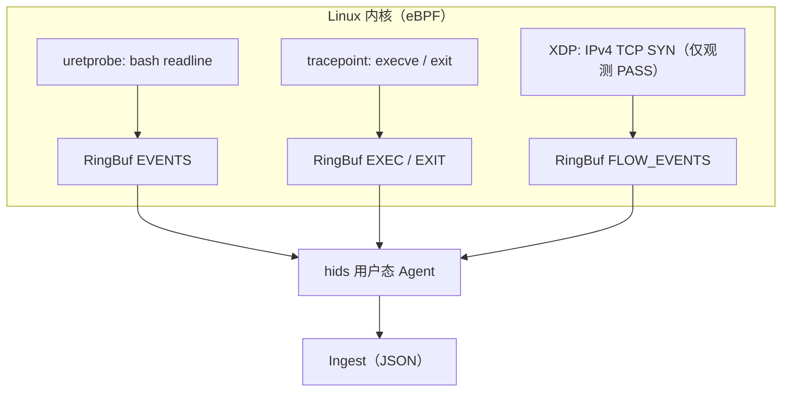

# HIDS 监测架构说明（eBPF 为主，仅观测、不阻断）

本文描述本仓库 **Agent 侧** 的监测能力与数据路径，便于你对接平台、做规则或扩容。设计原则是：**内核里尽量只做轻量、稳定、与 ABI 绑定的采集；重逻辑与关联放在用户态或 SIEM**。

---

## 1. 总体数据流

另有一条 **纯用户态** 路径：`pnet_datalink` 在选定网卡上抓包，解析明文 HTTP（`event_kind=3`，与 XDP flow 互补）。

---

## 2. eBPF 程序与事件类型对应

| 内核机制 | eBPF 入口（程序名） | 输出 Map | `event_kind`（用户态） | 说明 |
|----------|---------------------|----------|------------------------|------|
| **uretprobe** | `uretprobe_readline` | `EVENTS` (RingBuf) | **0** | 附加在 `/bin/bash` 的 `readline` 返回处，取用户输入行（交互式 shell 线索）。 |
| **tracepoint** | `trace_enter_execve` | `EXEC_EVENTS` (RingBuf) | **4** | `sys_enter_execve`，读 `filename` 用户指针，记录将执行的二进制路径。 |
| **tracepoint** | `trace_enter_exit` / `trace_enter_exit_group` | `EXIT_EVENTS` (RingBuf) | **5** | 进程/线程退出，记录 `exit_code`。 |
| **XDP** | `xdp_flow5tuple` | `FLOW_EVENTS` (RingBuf) | **2** | 入站 IPv4 **TCP**、目的端口在策略内（或全端口）、**SYN 且无 ACK** 时上报五元组；**始终 `XDP_PASS`**，不丢包、不改写业务。 |

配置项 **`proc_monitor_enabled`** 为 `false` 时，不加载上述 exec/exit tracepoint，也不从 `EXEC_EVENTS` / `EXIT_EVENTS` 读数据（避免事件风暴）。**默认代码中为 `false`**；示例配置里为 `true` 便于演示。

---

## 3. eBPF Maps（内核与用户态）

| Map 名 | 类型 | 用途 |
|--------|------|------|
| `EVENTS` / `EXEC_EVENTS` / `EXIT_EVENTS` / `FLOW_EVENTS` | RingBuf | 高频事件队列；用户态 `RingBuf::next()` 消费。 |
| `SKIP_IPS` | Hash(`u32`→`u8`) | 源与目的**同时**命中时可跳过（减少噪声），由配置 `xdp_skip_ips` 等填充。 |
| `LOCAL_IPS` | Hash(`u32`→`u8`) | 本机 IPv4 集合，用于 XDP 判断 **inbound**（`dst` 为本机）。 |
| `SENSITIVE_PORTS` | Hash(`u16`→`u8`) | 需要上报 flow 的 **目的端口** 列表；与 `xdp_sensitive_ports` 对应。 |
| `CAPTURE_ALL_PORTS` | Hash(`u8`→`u8`) | key=0 存在时，XDP 侧视为 **全端口** 监测（仍仅 SYN、仍 inbound）。 |

**说明**：端口策略在 **eBPF 内只做「是否值得记一条 flow」**，不做阻断；与「防火墙」无关。

---

## 4. XDP 程序逻辑摘要（`xdp_flow5tuple`）

1. 解析以太网 → IPv4 → TCP（非 TCP 直接 `PASS`）。
2. `SKIP_IPS` / `LOCAL_IPS` 判断方向；当前 **仅上报 inbound**（`direction == 1`）。
3. 目的端口：要么 `CAPTURE_ALL_PORTS` 开启（全部），要么目的端口在 `SENSITIVE_PORTS`。
4. 仅 **SYN 且非 ACK** 的包提交 `FlowEvent`（近似「新连接尝试」）。
5. 返回值恒为 **`XDP_PASS`**。

**局限**：仅 IPv4；UDP/ICMP 不在此程序中上报；与容器/多网卡场景下需正确配置 `xdp_iface` 与 `LOCAL_IPS`（本机地址检测为 best-effort）。

---

## 5. 用户态补充监测（非 eBPF）

| 能力 | 实现 | `event_kind` | 说明 |
|------|------|--------------|------|
| **HTTP L7** | `pnet_datalink` 抓包与解析 | **3** | 可配置端口、静态资源过滤、去重、Host/Cookie/响应码；明文 HTTP。 |
| **文件变更** | `notify`（inotify 类） | **6** | 配置 `file_watch_paths` 后递归监视目录；适合 `/etc`、站点根目录等。 |

---

## 6. 事件字段与平台侧关联建议

- **进程链**：`event_kind=4`（exec 路径）+ **5**（退出码）+ **0**（bash 行）在平台侧按 `tgid` / `pid` + `ts_ms` 关联。
- **网络**：`event_kind=2` 与 **3** 可使用 **`flow_correlation_key`**（`tcp:客户端:端口->服务端:端口`）做 JOIN。
- **schema_version**：见构建注入；新增字段尽量 **可选**，便于接收端兼容。

---

## 7. 运维与性能（成熟落地时要注意）

| 主题 | 建议 |
|------|------|
| **exec/exit 体量** | 高负载机器上 tracepoint 事件极多；默认关闭 `proc_monitor_enabled`，按需开启或平台侧采样。 |
| **XDP 事件量** | `xdp_capture_all_ports=true` 会显著增加 SYN 记录；敏感端口列表按资产裁剪更稳妥。 |
| **RingBuf 丢事件** | 用户态消费慢时内核可能丢弃；可增大 map、缩短批间隔、或内核侧聚合（未来扩展）。 |
| **权限** | 加载 BPF、XDP、抓包通常需 **root** 或等价 capabilities；见 `README.md`。 |
| **合规** | HTTP Header/Cookie 属敏感数据；生产应对 ingest 做脱敏、留存策略与访问审计。 |

---

## 8. 配置速查

| 配置 / 环境变量 | 作用 |
|------------------|------|
| `proc_monitor_enabled` / `HIDS_PROC_MONITOR_ENABLED` | 是否启用 exec/exit tracepoint。 |
| `file_watch_paths` / `HIDS_FILE_WATCH_PATHS`（分号分隔） | 监视目录列表。 |
| `xdp_sensitive_ports` / `xdp_capture_all_ports` | XDP flow 端口策略。 |
| `http_l7_ports` 等 | 用户态 HTTP 监测。 |

更完整的文件级说明见 [CODE_OVERVIEW.md](./CODE_OVERVIEW.md)。
