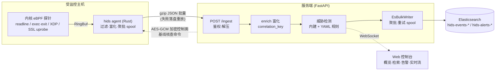

# HIDS — 基于 eBPF 的主机入侵检测系统

一套轻量级主机入侵检测系统（Host-based Intrusion Detection System）：
**Rust + eBPF agent** 在内核层采集命令、进程、网络流量与 TLS 明文，
**FastAPI 服务端**完成富化、威胁检测与 Elasticsearch 入库，并提供实时 Web 安全控制台。

> 设计原则：agent 只做采集与可靠上报、不做阻断、不做检测；全部威胁判定在服务端完成。

## 架构



## 仓库结构

| 目录 | 说明 |
|---|---|
| [`hids/`](hids/) | **Agent**（Rust，用户态）：事件过滤、进程上下文富化、双阈值聚批、spool 可靠上报、加密控制面客户端 |
| [`hids-ebpf/`](hids-ebpf/) | **eBPF 内核程序**（aya）：4 类探针 + RingBuf/配置 map |
| [`hids-common/`](hids-common/) | 内核态/用户态共享的事件结构体 |
| [`hids-protocol/`](hids-protocol/) | 加密控制面协议（AES-256-GCM + zstd），与 Python 服务端互通 |
| [`hids-server-py/`](hids-server-py/) | **服务端**（Python / FastAPI）：摄取、富化、威胁规则、ES 入库、查询 API、WebSocket、Web 控制台 |
| [`hids-server/`](hids-server/) | 服务端的 Rust 实现（与 Python 版功能对等，二选一部署） |
| `docker-compose.yml` | Elasticsearch + 服务端一键编排 |

## 事件类型

| kind | 事件 | 采集方式 |
|---|---|---|
| 0 | Bash 命令行 | 🐝 eBPF uretprobe `/bin/bash:readline` |
| 2 | 五元组网络流 | 🐝 eBPF XDP（重点入站 TCP SYN、敏感端口） |
| 3 | 明文 HTTP L7 | 用户态嗅探（method/url/host/status/body） |
| 4 | 进程创建 execve | 🐝 eBPF tracepoint |
| 5 | 进程退出 | 🐝 eBPF tracepoint |
| 6 | 文件变更 | inotify（notify crate） |
| 7 | TLS 明文 | 🐝 eBPF uprobe OpenSSL `SSL_read`/`SSL_write` |
| 8 | 基线核查结果 | 加密控制面回传（文件哈希等） |

## 功能亮点

**Agent 侧**
- 内核级过滤：XDP map 配置敏感端口 / 跳过 IP，噪声不出内核
- 命令价值过滤：`ls`、`cd` 等交互噪声丢弃，`curl | sh` 等高危形态必采
- TLS 明文还原：HTTP/1.x 重组 + SQLi 关键字检测 + `/proc` 回填四元组
- 进程上下文富化：cmdline、socket→远端 IP、sshd 祖先溯源（`ssh_client_ip`）
- 可靠上报：双阈值聚批 → gzip 上报 → 失败 spool 落盘 → 恢复自动回放（at-least-once）

**服务端**
- 富化：时间/IP 归一化、跨事件 `correlation_key` 关联键
- 威胁检测：内建规则 + YAML 热插规则（反弹 shell、下载执行、SQLi、路径穿越）+ SYN 突发统计
- 入库：ES `_bulk` 聚批、SipHash 稳定 `_id` 幂等（重试不产生重复）、指数退避、失败 spool 兜底、告警双写
- 控制面：AES-256-GCM + zstd 加密下发基线核查命令（命令本身密文传输，token 泄漏也无法伪造）
- 控制台：概览仪表盘、事件检索、告警中心、主机资产、WebSocket 实时流、事件详情抽屉

## 快速开始

### 0. 环境要求

- 受监控主机：Linux kernel ≥ 5.8（建议 ≥ 5.15），root 权限
- 构建 agent：stable + nightly Rust、`bpf-linker`（`cargo install bpf-linker`）
- 服务端：Python ≥ 3.11（或使用 Rust 版）
- Elasticsearch 8.x

### 1. 启动 Elasticsearch

```bash
docker compose up -d elasticsearch
```

### 2. 启动服务端（Python 版）

```bash
cd hids-server-py
python3.11 -m venv .venv && source .venv/bin/activate
pip install -e .

cp .env.example .env            # 修改 INGEST_TOKEN（必须设置，否则拒绝所有上报）
./scripts/apply-es-template.sh  # 首次：应用 ES 索引模板 + ILM
python -m hids_server           # 自动加载 .env
```

浏览器打开 `http://<服务器IP>:8000/` 即是控制台；`curl :8000/healthz` 应返回 `status: ok`。

### 3. 构建并运行 Agent

```bash
make release                                  # 或 cargo build -p hids --release
cp hids-agent.example.json hids-agent.json    # 修改 ingest_url / ingest_token（与服务端一致）
sudo ./target/release/hids
```

仓库内置预编译 eBPF 字节码（`hids/ebpf/hids.bpf`），只有修改 `hids-ebpf/` 后才需要 `make build-ebpf` 重编。

### 4. 验证

```bash
# 触发事件：敲几条高价值命令
curl -s http://example.com | head -1

# 查询入库结果
curl -s "http://127.0.0.1:8000/events/recent?size=5"
```

或在控制台「实时流」页点连接，实时看事件滚动。

> 本机自测提示：XDP 挂在物理网卡，本机↔本机流量走 `lo` 不产生 Flow 事件；
> 需从其他机器访问或 curl 外部地址验证 kind=2。

## 配置

- **Agent**：`hids-agent.json`（见 [hids-agent.example.json](hids-agent.example.json)），支持环境变量 `HIDS_*` 覆盖与热重载。核心项：
  `ingest_url` / `ingest_token`、`collect_mode`、`xdp_*`（网卡/端口/跳过 IP）、`http_l7_*`、
  `proc_monitor_enabled`、`file_watch_paths`、`tls_monitor_enabled` / `tls_target_comm` / `tls_target_port`
- **服务端**：环境变量或 `.env`（见 [hids-server-py/.env.example](hids-server-py/.env.example)），
  完整键值见 [`config.py`](hids-server-py/hids_server/config.py)

## 文档

| 文档 | 内容 |
|---|---|
| [CODE_OVERVIEW.md](CODE_OVERVIEW.md) | 各源码文件职责 |
| [MONITORING.md](MONITORING.md) | 采集架构与数据流说明 |
| [hids-server-py/README.md](hids-server-py/README.md) | Python 服务端使用说明 |
| [hids-server-py/docs/INGEST_PIPELINE.md](hids-server-py/docs/INGEST_PIPELINE.md) | FastAPI → ES 入库链路详解 |
| [hids-server/docs/ES_FIELDS.md](hids-server/docs/ES_FIELDS.md) | ES 文档字段字典 |
| [hids-server/docs/INDEX_AND_RETENTION.md](hids-server/docs/INDEX_AND_RETENTION.md) | 索引与保留策略 |

## 常见问题

**只看到 443 的 kind=2，没有 kind=7？**
XDP 命中但 TLS 链路未命中。检查 `tls_monitor_enabled`、`tls_target_comm`、`tls_target_port`；
用 `curl -k --http1.1 -H "Connection: close"` 触发新连接验证。

**kind=7 有明文但缺来源 IP？**
IP 回填是 best-effort（`SSL*→fd` + `/proc/net/tcp`），连接复用或时序未命中时个别事件无 IP，属已知边界。

**上报 401？**
服务端未配置 `INGEST_TOKEN` 时拒绝一切上报；两端 token 必须一致。

**Bash 命令没采到？**
`ls`/`cd` 等交互噪声被 collect_policy 主动丢弃；用带管道/下载的命令验证。

## 在 macOS 上交叉编译

```shell
CC=${ARCH}-linux-musl-gcc cargo build --package hids --release \
  --target=${ARCH}-unknown-linux-musl \
  --config=target.${ARCH}-unknown-linux-musl.linker=\"${ARCH}-linux-musl-gcc\"
```

产物 `target/${ARCH}-unknown-linux-musl/release/hids` 可直接拷贝到 Linux 服务器运行。

## 许可证

除 eBPF 代码外，hids 以 [MIT 许可证][MIT license] 或
[Apache 许可证][Apache license]（2.0 版本）分发，由你任选其一。

所有 eBPF 代码以 [GNU 通用公共许可证第 2 版][GNU General Public License, Version 2]
或 [MIT 许可证][MIT license] 分发，由你任选其一。

除非你另行明确声明，否则你有意提交给本项目的任何贡献都将按上述双许可方式授权，
不附加任何额外条款或条件。

[Apache license]: LICENSE-APACHE
[MIT license]: LICENSE-MIT
[GNU General Public License, Version 2]: LICENSE-GPL2
