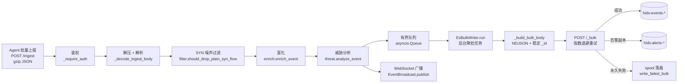

# FastAPI → Elasticsearch 入库链路（hids-server-py）

> 对应 Rust 版 `hids-server/src/{routes.rs, es_writer.rs, enrich.rs, threat/}` 的 Python 移植。
> 本文梳理 agent 上报 → FastAPI 路由 → 富化/威胁分析 → ES 批量写入的完整数据流。

## 1. 链路总览



## 2. 模块职责

| 模块 | 职责 | 对应 Rust |
|---|---|---|
| `app.py` | FastAPI 应用、全部路由、`AppState`、`/ingest` 入口 | `routes.rs` + `app.rs` + `lib.rs` |
| `enrich.py` | 时间戳归一、IP 归一、`correlation_key`、信封元数据注入 | `enrich.rs` |
| `filter.py` | 纯 SYN flow 事件降噪丢弃 | `filter.rs` |
| `threat.py` | 内建规则 + YAML 规则 + SYN 突发统计，写入 `threat.*` 字段 | `threat/` |
| `es_writer.py` | 后台聚批、`_bulk` 写入、重试、告警双写、失败 spool | `es_writer.rs` |
| `doc_id.py` | SipHash-1-3 稳定文档 `_id`（幂等写入） | `doc_id.rs` |
| `spool.py` | 失败批次落盘为 NDJSON 文件 | `spool.rs` |
| `metrics.py` | `/stats` 指标计数 | `metrics.rs` |
| `ws.py` | `/ws/events` 实时推送 | `ws.rs` |

## 3. 函数级调用链

### 3.1 请求阶段（`POST /ingest`，`app.py`）

```
ingest()                          app.py:172
├── _require_auth()               app.py:94    Bearer token 或 X-Api-Key
│   └── _authorize_ingest()       app.py:84
├── 请求体大小检查                 cfg.max_body_bytes
├── _decode_ingest_body()         app.py:103   gzip 解压（上限 64 MiB）+ JSON 解析
├── 构造 enrich.EnvelopeMeta      app.py:195   agent_version / schema_version / host_id / batch 统计
└── 逐事件循环:
    ├── flt.should_drop_plain_syn_flow()        纯 SYN flow 丢弃（计数 dropped_plain_syn_flow）
    └── _ingest_one()             app.py:159
        ├── enrich.enrich_event()               时间戳/IP 归一 + correlation_key
        ├── threat.analyze_event()              内建 + YAML 规则 → threat.* 字段
        ├── state.queue.put_nowait()            队满 → 503 QUEUE_FULL_MSG
        └── state.broadcast.publish()           WebSocket 实时推送
```

返回码约定（与 Rust 一致）：
- `202` `{accepted, batch_size}` — 接受
- `400` — 解析失败 / events 为空 / 过滤后无事件
- `401` — 鉴权失败（未配置 token 时一律 401）
- `503` — 入库队列满，agent 侧会重试

### 3.2 写入阶段（后台任务，`es_writer.py`）

生命周期：`create_app()` 的 `lifespan` 在启动时 `asyncio.create_task(es_writer.run())`，
关闭时 cancel → 冲刷残留 → `aclose()`。

```
EsBulkWriter.run()                es_writer.py:47   聚批主循环
└── _flush(buffer)                es_writer.py:71
    ├── resolve_write_index()     es_writer.py:26   es_daily_index=true 时追加 -YYYY.MM.DD
    ├── _build_bulk_body()        es_writer.py:90   NDJSON；es_document_id=true 时注入稳定 _id
    │   └── stable_document_id()  doc_id.py:17      SipHash-1-3，幂等去重
    ├── _post_bulk_with_retry()   es_writer.py:102  指数退避 (base * 2^n，封顶 2^6)
    │   └── _post_bulk_once()     es_writer.py:122  429/5xx/网络错误可重试，其余 4xx 不可
    │       └── POST /_bulk       content-type: application/x-ndjson
    ├── 告警双写: should_index_alert() 过滤 → hids-alerts-* 同样走 retry
    └── 永久失败且 label=events → spool.write_failed_bulk() 落盘
```

## 4. 可靠性设计

| 机制 | 实现 | 说明 |
|---|---|---|
| 背压 | `asyncio.Queue(maxsize=queue_capacity)` + 503 | agent 收到 503 后重试整批 |
| 幂等 | `stable_document_id()` 注入 `_id` | 整批重试不会产生重复文档 |
| 重试 | 指数退避，仅 429/5xx/网络错误 | 4xx 判定为不可恢复，立即放弃 |
| 兜底 | `spool_on_es_failure` → NDJSON 落盘 | 可用 `replay-spool.sh` 回放 |
| 优雅停机 | `CancelledError` 中冲刷残留 buffer | lifespan 控制 |

## 5. 与 Rust 版的差异记录

1. **聚批语义**（已对齐）：早期实现每拿到事件就冲刷，低流量下退化为一事件一请求；
   现 `run()` 与 Rust `es_writer.rs:91` 一致 —— buffer 累积到 `batch_size` **或**
   距首个缓冲事件超过 `flush_ms` 才冲刷。

2. **bulk 部分条目失败不会 spool**
   - `_post_bulk_once()` 对 HTTP 2xx 但 `errors: true` 的响应只计数 `es_bulk_item_errors` 并返回成功，失败条目丢失（Rust 版行为相同，属共同限制，文档记录）。

## 6. 相关配置（`config.py`，环境变量与 Rust 同名）

| 变量 | 作用 |
|---|---|
| `HIDS_ES_URL` / `HIDS_ES_USERNAME` / `HIDS_ES_PASSWORD` | ES 连接 |
| `HIDS_ES_INDEX` / `HIDS_ES_DAILY_INDEX` | 事件索引名 / 是否按天分索引 |
| `HIDS_ES_BATCH_SIZE` / `HIDS_ES_FLUSH_MS` | 聚批阈值 / 冲刷间隔 |
| `HIDS_ES_MAX_RETRIES` / `HIDS_ES_RETRY_BASE_MS` | 重试次数 / 退避基数 |
| `HIDS_ES_DOCUMENT_ID` | 是否注入稳定 `_id`（幂等） |
| `HIDS_ES_ALERTS_ENABLED` / `HIDS_ES_ALERTS_INDEX` / `HIDS_ES_ALERTS_MIN_LEVEL` | 告警双写 |
| `HIDS_SPOOL_ON_ES_FAILURE` / `HIDS_SPOOL_DIR` | 失败落盘 |
| `HIDS_QUEUE_CAPACITY` | 入库队列容量（背压） |
